# JobFinder AI

[](LICENSE)
[](jobfinder_n8n_workflow.json)
[](docker-compose.yml)
[](https://aistudio.google.com/apikey)

A self-hosted, **100% free-stack n8n job-hunting agent** that scrapes LinkedIn and NoFluffJobs, filters out mismatches before spending API tokens, scores postings with **Google Gemini** (`gemini-3.5-flash-lite`) against a deterministic rubric and strict office/location gate, generates **ATS-friendly PDF CVs & Cover Letters** via **Gotenberg**, and sends targeted alerts to **Discord**.

---

## Architecture

```mermaid
flowchart LR
    T["Triggers (Daily 07:30 / Manual)"] --> CFG["Initialize Profile and Settings"]
    CFG --> SEEN["Load seen_jobs.json"]
    SEEN --> LI["LinkedIn Guest API Queries"]
    SEEN --> NFJ["NoFluffJobs Search API"]
    LI --> DEDUP["Deduplicate & Title / Industry Pre-Filter"]
    NFJ --> DEDUP
    DEDUP --> LOOP["Loop 1 Job at a Time"]
    LOOP --> SCORE["Gemini 4-Part Scoring + JSON Repair"]
    SCORE --> GATE["Deterministic Caps & Location Gate"]
    GATE -- "70+ & Location Valid" --> CV["Gemini Tailored CV + CL JSON"]
    CV --> HTML["Render Single-Column ATS HTML"]
    HTML --> PDF["Gotenberg HTML-to-PDF"]
    PDF --> DISK["Save PDFs + Ping @everyone in Discord"]
    GATE -- "50-69 & Location Valid" --> MAYBE["Quiet Discord Maybe Alert"]
    GATE -- "Explicit Violation / Excluded" --> DROP["Drop Listing (SKIPPED)"]
```



---

## Key Features

- **100% Free Self-Hosted Stack:** Runs on self-hosted **n8n**, **Gotenberg 8**, **Google AI Studio Free Tier** (`gemini-3.5-flash-lite` with built-in 4s–5s rate-limit pauses and retries), and a **Discord Webhook**.
- **Zero-Cost Stage 1 Pre-Filtering:** Deduplicates against `/home/node/.n8n/seen_jobs.json` and filters out junior/intern roles, heavy unrelated stacks, excluded industries (crypto/Web3, gambling/iGaming, adult, forex/CFDs, MLM), and unwanted SWE developer titles before calling Gemini.
- **Deterministic 4-Part Scoring Rubric (`0–100`):**
  - **Role Fit (`0–35` pts):** Categorized into Tier 1 & Tier 2 tracks (`AI & Workflow Automation`, `Enterprise / MES & API Integration`, `Observability, Linux & DevOps`, `Technical Solutions / Integration Consultant`, or `Other / Mismatch`).
  - **Tech Stack Overlap (`0–30` pts):** Evaluates workflow orchestration, APIs, LLMs, SQL, Linux, Docker, monitoring, and scripting.
  - **AI-Proof Security & Stability (`0–20` pts):** Prioritizes permanent contracts and high AI resilience over L1 support/body-leasing agencies.
  - **Location & Compensation (`0–15` pts):** Checks Remote, primary-region office limits, secondary-city office limits, and disclosed salary ranges.
- **Strict Office Criteria & Warning System:**
  - **Explicit Violation -> Dropped (`SKIPPED`):** Jobs outside approved zones without Remote, explicitly Onsite-only, or exceeding your configured max office days/week are capped at `30` and forced to `SKIPPED` (never posted to Discord).
  - **Unspecified Hybrid -> Kept with Warning:** Hybrid or Unknown work-mode postings in approved areas without explicit office/HO day counts take a `-5` pt penalty and display a `⚠️ WARNING: Office/HO days unspecified...` banner.
- **Noise-Free Discord Alerts:**
  - **`70+` Strong Matches:** Generates clean single-column ATS PDF CVs via Gotenberg, saves them to `/home/node/.n8n`, and **pings `@everyone`** with PDF attachments and category tags (`📂 Category:`).
  - **`50–69` Maybe Matches:** Posts quietly without `@everyone` (mute non-mentions on your channel to be notified only when CVs are generated).
- **Schema-Enforced & Repaired Gemini JSON:** Uses Gemini `responseSchema` plus a string-aware JSON repair helper (`parseGeminiJson`) to strip trailing commas and escape control characters safely.
- **Configurable CV Languages:** Supports **English + optional 2nd language** (`hu` Hungarian, `de` German, `pl` Polish, or `none` for English-only) for both CVs and Cover Letters.

---

## Repository Structure

| Path | Tracked | Purpose |
| :--- | :---: | :--- |
| [`jobfinder_n8n_workflow.json`](jobfinder_n8n_workflow.json) | Yes | Ready-to-import 38-node n8n workflow built from the sanitized example profile. |
| [`scripts/build_workflow.py`](scripts/build_workflow.py) | Yes | Dual-mode Python generator supporting both `examples/config.example.json` and local private configs (`--local` / `--all`). |
| [`examples/config.example.json`](examples/config.example.json) | Yes | Sanitized configuration template (candidate header, models, Gotenberg URL, CV language, office caps, search queries). |
| [`examples/master_profile.example.md`](examples/master_profile.example.md) | Yes | Sanitized example Candidate Master Profile in Markdown. |
| [`docker-compose.yml`](docker-compose.yml) | Yes | Full self-hosted stack (`n8n` + `gotenberg` on a shared Docker network). |
| [`docker/docker-compose.gotenberg.yml`](docker/docker-compose.gotenberg.yml) | Yes | Standalone Gotenberg Compose file (with CasaOS metadata) for existing n8n setups. |
| [`SETUP_GUIDE.md`](SETUP_GUIDE.md) | Yes | Step-by-step installation, n8n credentials setup, and optional Data Table instructions. |
| `config.local.json`, `master_profile_*.md`, `*.local.json`, `*.pdf` | **Gitignored** | Your private resume data, local IP configs, and generated personal workflow stay untracked on disk. |

---

## Quick Start

### Option 1: Full Docker Compose Stack (New Users)

1. Clone this repository and start **n8n + Gotenberg**:
   ```bash
   docker compose up -d
   ```
2. Open n8n at `http://localhost:5678`.
3. Import [`jobfinder_n8n_workflow.json`](jobfinder_n8n_workflow.json) via **⋯ → Import from File...**.
4. Create two free credentials in n8n's **Credentials** tab (`Google Gemini(PaLM) Api` and `Discord Webhook`) and link them in the Gemini and Discord nodes. *(See [`SETUP_GUIDE.md`](SETUP_GUIDE.md) for details.)*
5. Open **`Initialize Profile and Settings`** in n8n to customize your name, email, search queries, and Master Profile (default `gotenberg_url` is already `http://gotenberg:3000`).

### Option 2: CasaOS / Existing n8n Instance

1. Deploy only Gotenberg using [`docker/docker-compose.gotenberg.yml`](docker/docker-compose.gotenberg.yml) (in CasaOS: **+ → Install a customized app → Import**).
2. Import [`jobfinder_n8n_workflow.json`](jobfinder_n8n_workflow.json) into your existing n8n UI.
3. Update `gotenberg_url` in **`Initialize Profile and Settings`** to `http://<YOUR_SERVER_LAN_IP>:3000` (or `http://gotenberg:3000` if on the same Docker network).

---

## Customization: No-Code vs. CLI Builder

- **No-Code (n8n UI):** All personal info, `candidate_profile`, `secondary_cv_language` (`"hu"`, `"de"`, `"pl"`, or `"none"`), office-day limits (`primary_region_max_office_days`, `secondary_city_max_office_days`), `gotenberg_url`, and `search_queries_json` are stored directly in **`Initialize Profile and Settings`**. *(Note: if switching `secondary_cv_language` to `"none"` directly inside n8n UI without rebuilding, also remove the 2nd attachment field `doc_secondary` in **`Send Strong Match PDFs to Discord`**.)*
- **CLI Builder (Recommended for Private Gitignored Workflows):**
  1. Copy [`examples/config.example.json`](examples/config.example.json) to `config.local.json` and create your own `master_profile.local.md`.
  2. Edit `config.local.json` (`profile_path`, `output_path: "jobfinder_n8n_workflow.local.json"`, `gotenberg_url`, `candidate`, and `search_queries`).
  3. Generate your private workflow without touching tracked files:
     ```bash
     python scripts/build_workflow.py --local
     ```
  4. Or rebuild both public example and local personal workflows at once:
     ```bash
     python scripts/build_workflow.py --all
     ```

---

## Privacy

Personal profiles (`master_profile_daniel_molnar.md`, `*.local.md`), local configs (`config.local.json`), local generated workflows (`*.local.json`), PDF resumes (`*.pdf`), and `seen_jobs.json` are excluded in [`.gitignore`](.gitignore) so private contact details and LAN IPs are never pushed to GitHub.

---

## License

Released under the [MIT License](LICENSE) — Copyright (c) 2026 Dániel Molnár.
